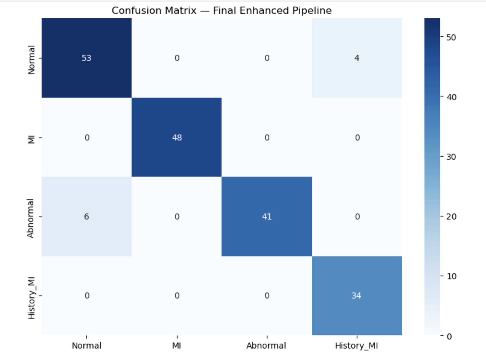
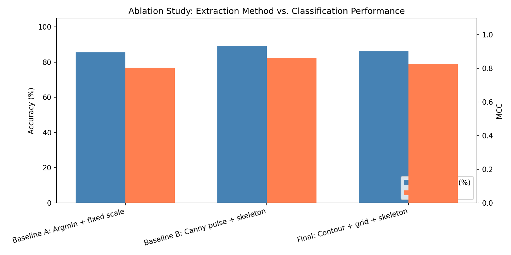
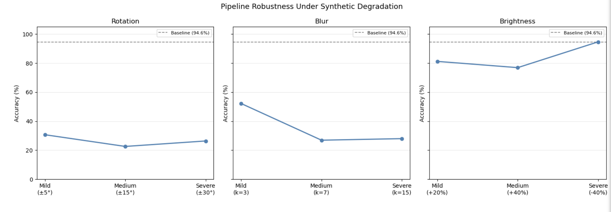

# Domain Shift and Format Sensitivity in ECG Image Classification Pipelines

An end-to-end biomedical AI pipeline that reconstructs digital ECG signals from paper-style ECG images and investigates how well deep-learning models generalize across different image formats, rendering conventions, and datasets.

**Status:** Research manuscript in preparation  
**Institutions:** Khalifa University and ETH Zurich  
**Supervision:** Dr. Mohamed Elgendi, Khalifa University, and Prof. Dr. Carlo Menon, ETH Zurich

## Project Overview

Many ECG records still exist as printed sheets, scans, photographs, PDFs, or raster-image exports rather than native digital signals. This project developed an end-to-end pipeline that reconstructs ECG waveforms from images and classifies them into four categories:

- Normal
- Myocardial infarction
- Abnormal
- History of myocardial infarction

The main goal was not only to achieve strong classification performance, but also to test whether that performance remained reliable when the image source, grid style, rendering process, or image quality changed.

## Pipeline

The workflow included:

1. Image standardization
2. Signal-quality estimation
3. ECG grid and calibration-pulse detection
4. Physical scaling using the 10 mm/mV ECG standard
5. Otsu thresholding
6. Zhang-Suen skeletonization
7. Fixed 3 × 4 segmentation into 12 lead regions
8. Reconstruction of each lead as a one-dimensional signal
9. Resampling to a 12 × 1000 model input
10. Classification using a 1D-ResNet
11. Ablation testing
12. Synthetic degradation testing
13. Cross-dataset evaluation using PTB-XL-derived ECG images

## Within-Dataset Results

The final enhanced pipeline achieved:

- Accuracy: 94.62%
- Matthews Correlation Coefficient: 0.9287

## Ablation Study

Alternative extraction methods were compared to evaluate how calibration and preprocessing affected downstream classification.

## Robustness Evaluation

The trained system was tested under synthetic rotation, blur, and brightness changes. Rotation and blur caused substantial performance loss, while brightness changes had a smaller effect.

## Main Finding

The strongest result was not the within-dataset accuracy.

When the pipeline was evaluated on differently rendered PTB-XL images, zero-shot performance dropped to approximately chance level. This showed that the system was highly sensitive to grid appearance, grayscale behavior, layout assumptions, rendering conventions, and label mapping.

The central conclusion is that strong performance on one ECG image dataset does not demonstrate robustness across datasets or image formats.

## My Contribution

I carried out the experimental development and evaluation of the ECG image-processing and classification pipeline under the supervision of Dr. Mohamed Elgendi at Khalifa University.

My work included:

- Developing and refining the digitization pipeline
- Implementing calibration, trace extraction, and waveform reconstruction
- Training and evaluating the 1D-ResNet classifier
- Conducting ablation experiments
- Designing synthetic degradation tests
- Performing cross-dataset domain-shift evaluation
- Analyzing failure modes and contributing to the manuscript

## Current Status

The experimental work is complete, and the manuscript is being finalized for submission.

The source code is currently withheld pending research and publication approval.

## Supervision and Collaboration

Conducted at Khalifa University under the supervision of Dr. Mohamed Elgendi, Department of Biomedical Engineering and Biotechnology, in collaboration with Prof. Dr. Carlo Menon and ETH Zurich.

## Disclaimer

This is an experimental research project and not a clinically validated diagnostic system.
