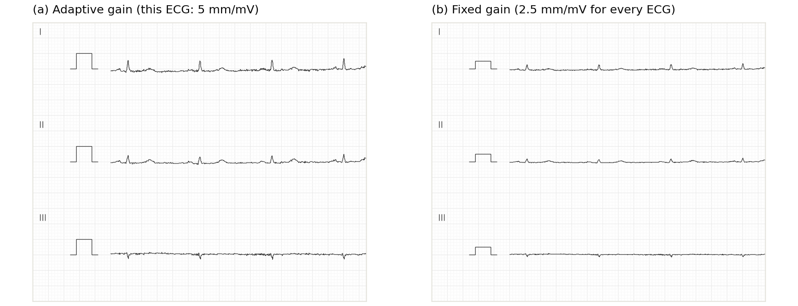
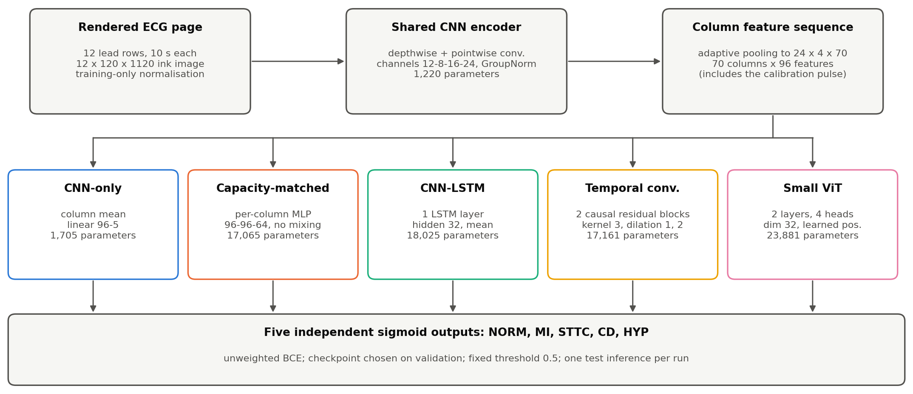
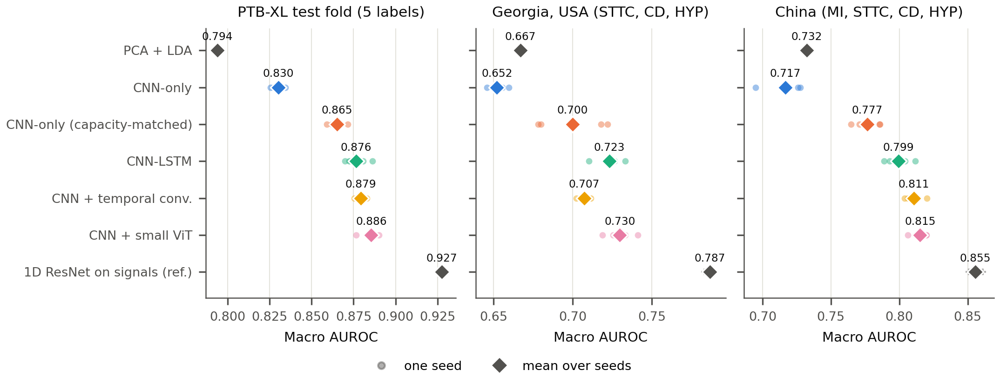

# Rendering gain and sequence modelling in 12-lead ECG-image classification

A controlled, reproducible comparison of compact image models for classifying 12-lead ECGs drawn as
paper-style pages, with an external test on hospitals in the USA and China.

Miriam Istanboli, supervised by Mohamed Yousry Elgendi. Manuscript in preparation.

> **Earlier version.** Until September 2026 this repository held a different, earlier project (Mendeley ECG
> images, domain shift to PTB-XL, a 1D-ResNet notebook). That version is kept unchanged under the Git tag
> [`v1-mendeley-2026-09`](https://github.com/itsmiri-eng/ecg-image-gain-sequence-models/tree/v1-mendeley-2026-09) and in the commit history.



## What the study does

- **Data.** All 21,388 labelled PTB-XL v1.0.3 ECGs, drawn as calibrated paper-style pages (8 px/mm, 25 mm/s,
  12 stacked lead rows), with five overlapping diagnostic labels: NORM, MI, STTC, CD, HYP.
  Official patient folds: 1–8 train, 9 validation, 10 test.
- **Models.** All networks share one 1,220-parameter CNN encoder and differ only in the head:
  CNN-only, a capacity-matched CNN-only head, CNN-LSTM, CNN + temporal convolution and CNN + small ViT.
  References: PCA + LDA, PCA + linear SVM, and a 1D ResNet on the raw signals.
- **Rendering.** Every model is trained twice: on pages with the original *adaptive* gain (smaller gain for
  high-voltage ECGs) and on pages redrawn at a *fixed* 2.5 mm/mV.
- **Protocol.** Hyperparameters fixed in advance, 5 training seeds per network, checkpoint chosen on validation,
  threshold fixed at 0.5, one test inference per run, hierarchical (seed × patient) bootstrap with Holm
  correction.
- **External test.** Run once, under an analysis plan frozen before the data were opened: Georgia, USA
  (6,047 ECGs) and Chapman-Shaoxing + Ningbo, China (9,004 ECGs), from the PhysioNet/CinC Challenge 2021.



## Main results

Macro AUROC, mean ± SD over training seeds (5 seeds; ResNet-18: 3 seeds). PTB-XL = test fold 10 (exploratory).

| Model | Gain | PTB-XL | Georgia (USA) | China |
|---|---|---:|---:|---:|
| CNN-only | adaptive | 0.830 ± 0.004 | 0.652 ± 0.005 | 0.717 ± 0.013 |
| CNN-only, capacity-matched | adaptive | 0.865 ± 0.005 | 0.700 ± 0.021 | 0.777 ± 0.009 |
| CNN-LSTM | adaptive | 0.876 ± 0.007 | 0.723 ± 0.008 | 0.799 ± 0.009 |
| CNN + temporal conv. | adaptive | 0.879 ± 0.003 | 0.707 ± 0.004 | 0.811 ± 0.006 |
| CNN + small ViT | adaptive | 0.886 ± 0.005 | 0.730 ± 0.008 | 0.815 ± 0.006 |
| ResNet-18, ImageNet-pretrained (sensitivity analysis) | adaptive | 0.921 ± 0.001 | 0.773 ± 0.001 | 0.848 ± 0.003 |
| CNN-only | fixed | 0.860 ± 0.005 | 0.707 ± 0.006 | 0.768 ± 0.011 |
| CNN-only, capacity-matched (additional analysis, 15 Nov 2026) | fixed | 0.883 ± 0.006 | 0.733 ± 0.004 | 0.809 ± 0.006 |
| CNN-LSTM | fixed | 0.889 ± 0.005 | 0.738 ± 0.004 | 0.817 ± 0.007 |
| CNN + temporal conv. | fixed | 0.895 ± 0.001 | 0.738 ± 0.006 | 0.824 ± 0.008 |
| CNN + small ViT | fixed | 0.891 ± 0.007 | 0.737 ± 0.007 | 0.819 ± 0.005 |
| ResNet-18, ImageNet-pretrained (sensitivity analysis) | fixed | 0.929 ± 0.002 | 0.779 ± 0.004 | 0.853 ± 0.002 |
| 1D ResNet on signals (reference) | — | 0.927 ± 0.001 | 0.787 ± 0.002 | 0.855 ± 0.005 |

External macro AUROC covers only the labels that can be scored in each cohort (NORM is not scorable externally,
MI not in Georgia). Full tables: [paper/ieee_manuscript/tables/](paper/ieee_manuscript/tables/) and the
Supplementary Information source [paper/ieee_manuscript/supplementary_scirep.tex](paper/ieee_manuscript/supplementary_scirep.tex).

"Statistically supported" below means a Holm-adjusted bootstrap p < 0.05 (10,000 resamples, finite-resample
p-values; see [the statistical revision](docs/protocol_amendment_2026-11-15_bootstrap_inference.md)). No
non-inferiority or equivalence was tested.

1. **Sequence heads versus capacity.** With adaptive gain, heads that relate information along each lead row were
   0.011–0.020 macro AUROC above a capacity-matched head that cannot mix positions on PTB-XL (supported), and the
   ordering was reproduced externally. The difference halved with 40 epochs, and on fixed-gain pages it was small
   (0.004–0.015) and supported only for some heads and cohorts. The three sequence heads could not be ranked.
2. **Adaptive page gain carries hypertrophy information.** Gain alone predicts HYP with AUROC 0.72–0.74.
   Attribution and pulse-swap results are consistent with whole-row models reading the calibration pulse as a
   voltage scale; they do not prove it.
3. **Fixed-gain rendering: supported gains for some models, not all.** Supported on PTB-XL and both external
   cohorts for the heads without row-wide context (CNN-only, capacity-matched, temporal conv.). For the ViT on
   PTB-XL and for ResNet-18 externally the differences were positive but not supported. For the linear PCA + LDA
   baseline, macro AUROC was lower with fixed gain on PTB-XL (0.794 to 0.781) and in Georgia.
4. **Best image model.** The pretrained ResNet-18 (0.929 with fixed gain) was the best image model, not a compact
   one; the best compact model was the temporal-convolution head (0.895). Compact image models were 0.03–0.14 below
   the signal reference; ResNet-18 was within 0.015 of it.
5. **External labels.** The SNOMED CT mapping left 41% (Georgia) and 80% (China) of records without a label; the
   sensitivity of the results to the mapping is reported in the Supplementary Information.



## Limitations

- Pages are clean synthetic renderings; there are no real scans or phone photos.
- The PTB-XL test fold had been looked at before the models were specified, so PTB-XL comparisons are
  exploratory. The external test is the confirmatory evidence.
- External labels come from a data-driven SNOMED CT mapping that no cardiologist reviewed; NORM (and MI in
  Georgia) could not be scored, and most Chinese records had no mapped label.
- Statistical inference is approximate: only five training seeds (three in the sensitivity analyses) are
  resampled, and the external cohorts have no patient identifiers.
- The models are deliberately small.
- Seed 42 of the four original networks was trained on a laptop CPU; every other run used a GPU. Each run
  records its device.

## Reproducing

Start with [docs/REPRODUCIBILITY.md](docs/REPRODUCIBILITY.md): environment, data, the exact commands, and what
reproduces bit-for-bit and what does not.

```bash
python -m venv .venv
.venv\Scripts\activate          # Windows; on macOS/Linux: source .venv/bin/activate
pip install -r requirements.txt  # exact versions: environment/requirements-lock-pc-2026-11-03.txt
python -X utf8 -m src.check_pc_setup
python -X utf8 -m pytest -q tests
```

This repository holds code, frozen configs and protocols, and every run's record (config, code and data hashes,
source snapshot, saved predictions and metrics). It does **not** hold PTB-XL, the Challenge 2021 data, the
rendered pages and image caches, or model checkpoints. PTB-XL and the Challenge data are free on
[PhysioNet](https://physionet.org/content/ptb-xl/1.0.3/) (CC BY 4.0); the caches are rebuilt by the commands in
REPRODUCIBILITY.md, which check SHA-256 hashes against the recorded ones.

`.gitattributes` stores every file byte-for-byte, so hash-bound records verify on any operating system.

## Repository layout

```text
src/            data preparation, rendering, models, training, evaluation, analysis scripts
tests/          tests on synthetic data (python -X utf8 -m pytest -q tests)
experiments/    frozen configs, protocols, external-test plan, append-only experiment log, run logs
results/        per-run records and predictions, comparisons, publication figures
models/         per-run training histories and curves (checkpoints are not in Git)
data/           audits, splits and manifests of the derived datasets (no raw data)
docs/           protocols, reports, model cards, data statement, project status
paper/          experiment notes and manuscript drafts
environment/    exact package lock file
```

Protocols, all written before the runs they govern: [fixed gain](docs/ptbxl_fixed_gain_protocol.md),
[secondary analyses](docs/secondary_analyses_protocol.md),
[amendment of 3 Nov 2026](docs/protocol_amendment_2026-11-03.md),
[external test plan](docs/external_test_plan.md), the amendments of 11 Nov 2026 (40-epoch sensitivity, ResNet-18,
signal seeds) and of 15 Nov 2026 (capacity-matched head on fixed gain, bootstrap p-values, label-mapping
sensitivity), all in [docs/](docs/). The full list is in [docs/REPRODUCIBILITY.md](docs/REPRODUCIBILITY.md). Model cards: [docs/model_cards.md](docs/model_cards.md).
Data statement: [docs/data_statement.md](docs/data_statement.md).

## Data credits

- Wagner P. et al. PTB-XL, a large publicly available electrocardiography dataset. *Scientific Data* 7, 154
  (2020). PhysioNet, v1.0.3.
- Reyna M. A. et al. Will Two Do? Varying Dimensions in Electrocardiography: The PhysioNet/Computing in Cardiology
  Challenge 2021. PhysioNet, v1.0.3 (2022), doi:10.13026/34va-7q14 (Georgia, Chapman-Shaoxing, Ningbo).
- Goldberger A. L. et al. PhysioBank, PhysioToolkit, and PhysioNet. *Circulation* 101, e215–e220 (2000).

## Licence and citation

No licence has been chosen yet, so all rights are reserved by the authors for now. Please contact the authors
before reusing the code. A citation will be added when the manuscript is published.
