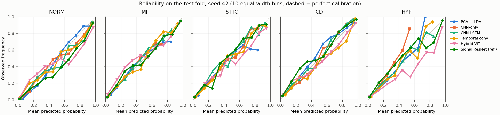

# Calibration and validation-chosen thresholds

Generated by `python -m src.analyze_calibration_thresholds` from saved predictions (protocol: docs/secondary_analyses_protocol.md). 0.5 remains the primary threshold; test results are exploratory.

| Run | Val macro ECE | Test macro ECE | Test macro Brier | Test macro F1 at 0.5 | Test macro F1 at validation thresholds |
|---|---:|---:|---:|---:|---:|
| ptbxl_v2_cnn_lstm_seed43 | 0.0221 | 0.0297 | 0.1056 | 0.6458 | 0.6789 |
| ptbxl_v2_cnn_lstm_seed44 | 0.0213 | 0.0259 | 0.1032 | 0.6527 | 0.6904 |
| ptbxl_v2_cnn_lstm_seed45 | 0.0213 | 0.0257 | 0.1080 | 0.6364 | 0.6661 |
| ptbxl_v2_cnn_lstm_seed46 | 0.0160 | 0.0221 | 0.1074 | 0.6376 | 0.6721 |
| ptbxl_v2_cnn_pool_seed42 | 0.0240 | 0.0253 | 0.1232 | 0.4958 | 0.6055 |
| ptbxl_v2_cnn_pool_seed43 | 0.0224 | 0.0253 | 0.1259 | 0.4941 | 0.5931 |
| ptbxl_v2_cnn_pool_seed44 | 0.0287 | 0.0285 | 0.1263 | 0.4809 | 0.6022 |
| ptbxl_v2_cnn_pool_seed45 | 0.0227 | 0.0242 | 0.1244 | 0.4909 | 0.6017 |
| ptbxl_v2_cnn_pool_seed46 | 0.0232 | 0.0249 | 0.1240 | 0.4870 | 0.6093 |
| ptbxl_v2_cnn_pool_wide_seed42 | 0.0242 | 0.0311 | 0.1119 | 0.5667 | 0.6430 |
| ptbxl_v2_cnn_pool_wide_seed43 | 0.0254 | 0.0269 | 0.1106 | 0.6036 | 0.6483 |
| ptbxl_v2_cnn_pool_wide_seed44 | 0.0261 | 0.0277 | 0.1144 | 0.5777 | 0.6462 |
| ptbxl_v2_cnn_pool_wide_seed45 | 0.0216 | 0.0237 | 0.1117 | 0.5712 | 0.6410 |
| ptbxl_v2_cnn_pool_wide_seed46 | 0.0228 | 0.0283 | 0.1100 | 0.6043 | 0.6582 |
| ptbxl_v2_hybrid_vit_seed43 | 0.0462 | 0.0459 | 0.1039 | 0.6743 | 0.6893 |
| ptbxl_v2_hybrid_vit_seed44 | 0.0343 | 0.0417 | 0.1040 | 0.6673 | 0.6786 |
| ptbxl_v2_hybrid_vit_seed45 | 0.0401 | 0.0442 | 0.1089 | 0.6471 | 0.6787 |
| ptbxl_v2_hybrid_vit_seed46 | 0.0389 | 0.0472 | 0.1055 | 0.6671 | 0.6858 |
| ptbxl_v2_lda_seed42 | 0.0261 | 0.0225 | 0.1415 | 0.4034 | 0.5636 |
| ptbxl_v2_lda_wide_seed42 | 0.0320 | 0.0259 | 0.1400 | 0.4269 | 0.5695 |
| ptbxl_v2_svm_seed42 | 0.0288 | 0.0217 | 0.1395 | 0.4109 | 0.5705 |
| ptbxl_v2_temporal_conv_seed43 | 0.0341 | 0.0383 | 0.1038 | 0.6317 | 0.6755 |
| ptbxl_v2_temporal_conv_seed44 | 0.0230 | 0.0300 | 0.1045 | 0.6388 | 0.6727 |
| ptbxl_v2_temporal_conv_seed45 | 0.0362 | 0.0382 | 0.1042 | 0.6255 | 0.6780 |
| ptbxl_v2_temporal_conv_seed46 | 0.0286 | 0.0341 | 0.1064 | 0.6171 | 0.6632 |
| ptbxl_v2_fg_cnn_lstm_seed42 | 0.0224 | 0.0247 | 0.1035 | 0.6406 | 0.6842 |
| ptbxl_v2_fg_cnn_lstm_seed43 | 0.0180 | 0.0243 | 0.1027 | 0.6638 | 0.6796 |
| ptbxl_v2_fg_cnn_lstm_seed44 | 0.0232 | 0.0269 | 0.1022 | 0.6680 | 0.6829 |
| ptbxl_v2_fg_cnn_lstm_seed45 | 0.0236 | 0.0278 | 0.0981 | 0.6751 | 0.7079 |
| ptbxl_v2_fg_cnn_lstm_seed46 | 0.0226 | 0.0258 | 0.0999 | 0.6740 | 0.6972 |
| ptbxl_v2_fg_cnn_pool_seed42 | 0.0215 | 0.0216 | 0.1168 | 0.5669 | 0.6357 |
| ptbxl_v2_fg_cnn_pool_seed43 | 0.0252 | 0.0237 | 0.1110 | 0.5956 | 0.6544 |
| ptbxl_v2_fg_cnn_pool_seed44 | 0.0203 | 0.0246 | 0.1138 | 0.5815 | 0.6483 |
| ptbxl_v2_fg_cnn_pool_seed45 | 0.0209 | 0.0157 | 0.1164 | 0.5773 | 0.6345 |
| ptbxl_v2_fg_cnn_pool_seed46 | 0.0226 | 0.0248 | 0.1132 | 0.5884 | 0.6524 |
| ptbxl_v2_fg_hybrid_vit_seed42 | 0.0478 | 0.0488 | 0.1002 | 0.6844 | 0.7108 |
| ptbxl_v2_fg_hybrid_vit_seed43 | 0.0406 | 0.0485 | 0.1069 | 0.6693 | 0.6761 |
| ptbxl_v2_fg_hybrid_vit_seed44 | 0.0340 | 0.0381 | 0.1012 | 0.6768 | 0.6960 |
| ptbxl_v2_fg_hybrid_vit_seed45 | 0.0336 | 0.0380 | 0.1005 | 0.6844 | 0.6969 |
| ptbxl_v2_fg_hybrid_vit_seed46 | 0.0465 | 0.0501 | 0.1048 | 0.6770 | 0.6932 |
| ptbxl_v2_fg_lda_seed42 | 0.0337 | 0.0332 | 0.1426 | 0.4496 | 0.5650 |
| ptbxl_v2_fg_temporal_conv_seed42 | 0.0253 | 0.0329 | 0.0972 | 0.6786 | 0.7099 |
| ptbxl_v2_fg_temporal_conv_seed43 | 0.0265 | 0.0254 | 0.0980 | 0.6776 | 0.7057 |
| ptbxl_v2_fg_temporal_conv_seed44 | 0.0265 | 0.0255 | 0.0990 | 0.6781 | 0.6984 |
| ptbxl_v2_fg_temporal_conv_seed45 | 0.0239 | 0.0258 | 0.0987 | 0.6742 | 0.6974 |
| ptbxl_v2_fg_temporal_conv_seed46 | 0.0225 | 0.0300 | 0.0997 | 0.6821 | 0.7001 |
| ptbxl_v2_signal_resnet1d_seed42 | 0.0340 | 0.0345 | 0.0820 | 0.7306 | 0.7461 |
| ptbxl_v2_signal_resnet1d_seed43 | 0.0214 | 0.0229 | 0.0810 | 0.7427 | 0.7522 |
| ptbxl_v2_signal_resnet1d_seed44 | 0.0274 | 0.0306 | 0.0827 | 0.7295 | 0.7501 |
| ptbxl_cnn_lstm_image_v1_seed42 | 0.0211 | 0.0278 | 0.1100 | 0.6131 | 0.6555 |
| ptbxl_spatiotemporal_image_v1_seed42 | 0.0224 | 0.0232 | 0.1035 | 0.6409 | 0.6705 |
| ptbxl_hybrid_vit_image_v1_seed42 | 0.0438 | 0.0503 | 0.1040 | 0.6717 | 0.6861 |

