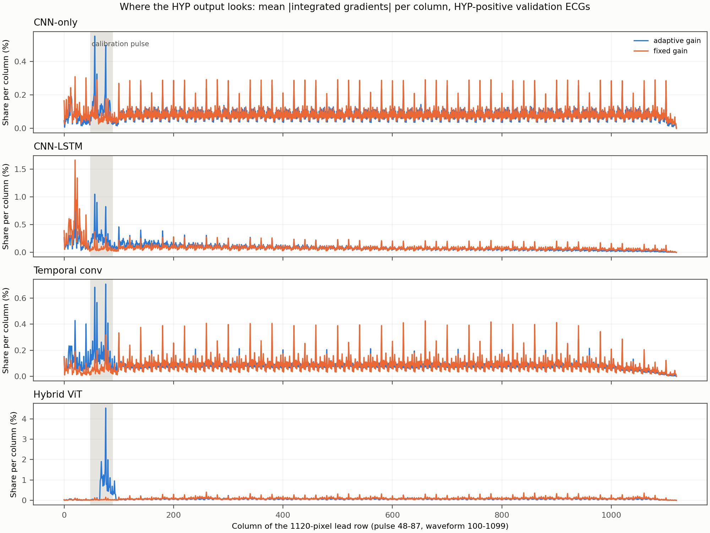

# Saliency: does the HYP output use the calibration pulse?

Generated by `python -m src.analyze_saliency` (protocol: docs/secondary_analyses_protocol.md, C). Validation ECGs only; integrated gradients, 16 steps, blank-page baseline. Pulse columns cover 3.6% of each row.

| Model | Pages / model | Logit | ECGs | Pulse share [95% CI] | Waveform share |
|---|---|---|---|---|---:|
| CNN-only | adaptive gain | HYP | HYP-positive (n=268) | 5.33% [5.04%, 5.62%] | 90.44% |
| CNN-only | adaptive gain | HYP | HYP-negative (n=268) | 4.26% [4.05%, 4.49%] | 91.22% |
| CNN-only | adaptive gain | NORM | HYP-positive (n=268) | 4.20% [4.02%, 4.38%] | 91.72% |
| CNN-only | adaptive gain | NORM | HYP-negative (n=268) | 3.90% [3.77%, 4.04%] | 91.73% |
| CNN-only | fixed gain | HYP | HYP-positive (n=268) | 3.15% [3.13%, 3.16%] | 90.25% |
| CNN-only | fixed gain | HYP | HYP-negative (n=268) | 3.27% [3.26%, 3.29%] | 89.89% |
| CNN-only | fixed gain | NORM | HYP-positive (n=268) | 3.26% [3.25%, 3.27%] | 90.54% |
| CNN-only | fixed gain | NORM | HYP-negative (n=268) | 3.31% [3.30%, 3.33%] | 90.40% |
| CNN-LSTM | adaptive gain | HYP | HYP-positive (n=268) | 11.38% [10.90%, 11.87%] | 78.29% |
| CNN-LSTM | adaptive gain | HYP | HYP-negative (n=268) | 10.89% [10.46%, 11.35%] | 78.08% |
| CNN-LSTM | adaptive gain | NORM | HYP-positive (n=268) | 6.42% [6.12%, 6.72%] | 87.28% |
| CNN-LSTM | adaptive gain | NORM | HYP-negative (n=268) | 6.03% [5.69%, 6.39%] | 87.90% |
| CNN-LSTM | fixed gain | HYP | HYP-positive (n=268) | 3.23% [3.16%, 3.30%] | 78.57% |
| CNN-LSTM | fixed gain | HYP | HYP-negative (n=268) | 3.45% [3.39%, 3.52%] | 74.82% |
| CNN-LSTM | fixed gain | NORM | HYP-positive (n=268) | 3.55% [3.47%, 3.63%] | 80.14% |
| CNN-LSTM | fixed gain | NORM | HYP-negative (n=268) | 3.40% [3.32%, 3.48%] | 78.49% |
| Temporal conv | adaptive gain | HYP | HYP-positive (n=268) | 7.59% [7.07%, 8.15%] | 85.58% |
| Temporal conv | adaptive gain | HYP | HYP-negative (n=268) | 9.64% [9.25%, 10.04%] | 82.51% |
| Temporal conv | adaptive gain | NORM | HYP-positive (n=268) | 4.11% [3.91%, 4.31%] | 91.68% |
| Temporal conv | adaptive gain | NORM | HYP-negative (n=268) | 2.77% [2.62%, 2.92%] | 94.23% |
| Temporal conv | fixed gain | HYP | HYP-positive (n=268) | 2.73% [2.60%, 2.85%] | 93.96% |
| Temporal conv | fixed gain | HYP | HYP-negative (n=268) | 2.76% [2.66%, 2.88%] | 93.72% |
| Temporal conv | fixed gain | NORM | HYP-positive (n=268) | 1.87% [1.82%, 1.93%] | 94.22% |
| Temporal conv | fixed gain | NORM | HYP-negative (n=268) | 2.10% [2.04%, 2.16%] | 93.92% |
| Hybrid ViT | adaptive gain | HYP | HYP-positive (n=268) | 24.69% [23.77%, 25.50%] | 70.60% |
| Hybrid ViT | adaptive gain | HYP | HYP-negative (n=268) | 14.79% [13.84%, 15.74%] | 81.85% |
| Hybrid ViT | adaptive gain | NORM | HYP-positive (n=268) | 9.73% [9.09%, 10.28%] | 87.18% |
| Hybrid ViT | adaptive gain | NORM | HYP-negative (n=268) | 5.94% [5.50%, 6.41%] | 91.68% |
| Hybrid ViT | fixed gain | HYP | HYP-positive (n=268) | 1.43% [1.38%, 1.48%] | 96.58% |
| Hybrid ViT | fixed gain | HYP | HYP-negative (n=268) | 1.58% [1.53%, 1.62%] | 96.11% |
| Hybrid ViT | fixed gain | NORM | HYP-positive (n=268) | 1.46% [1.40%, 1.53%] | 96.42% |
| Hybrid ViT | fixed gain | NORM | HYP-negative (n=268) | 1.64% [1.58%, 1.71%] | 95.94% |

